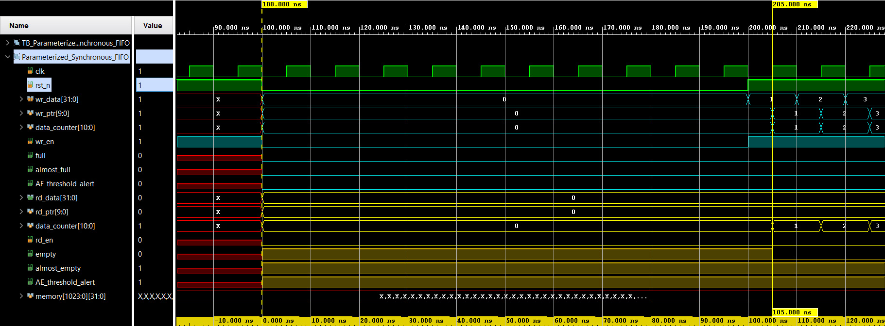
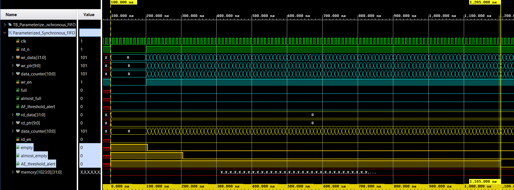
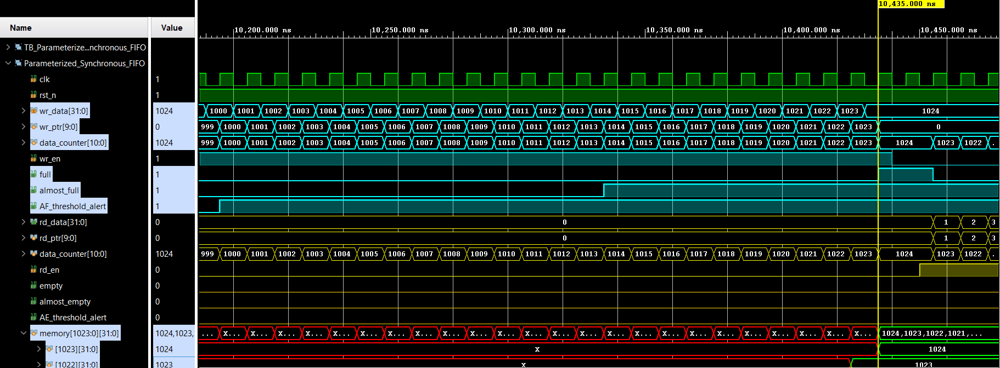
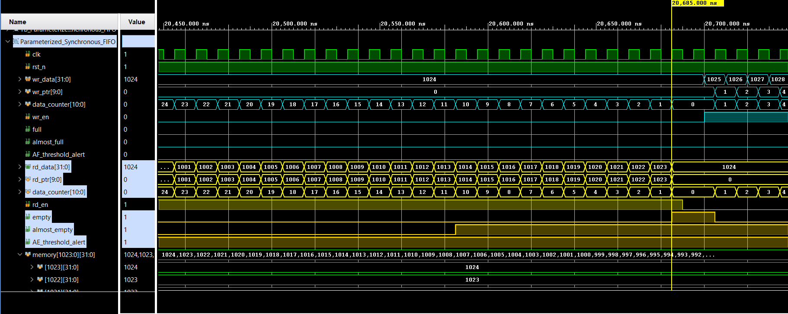
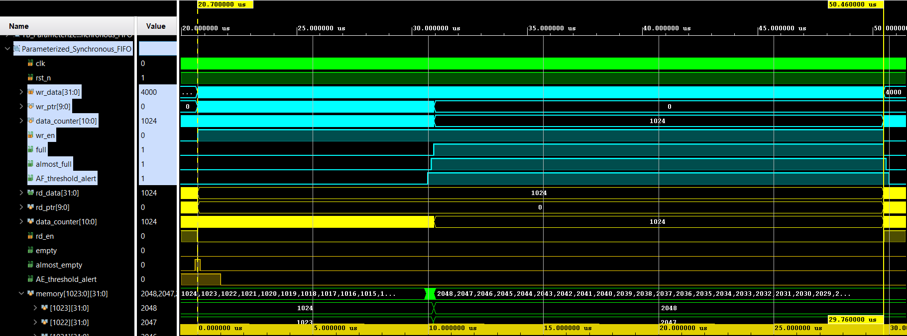
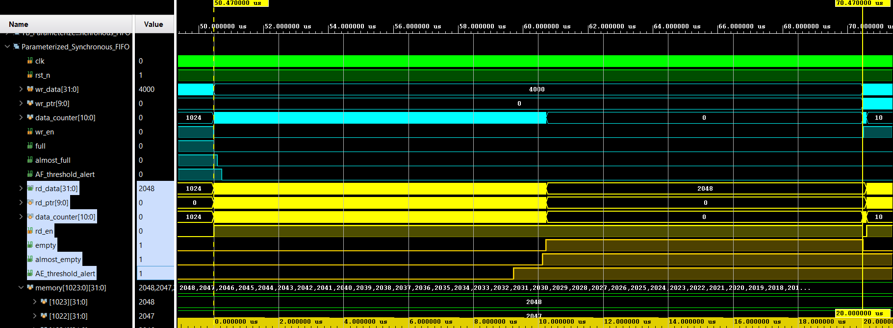
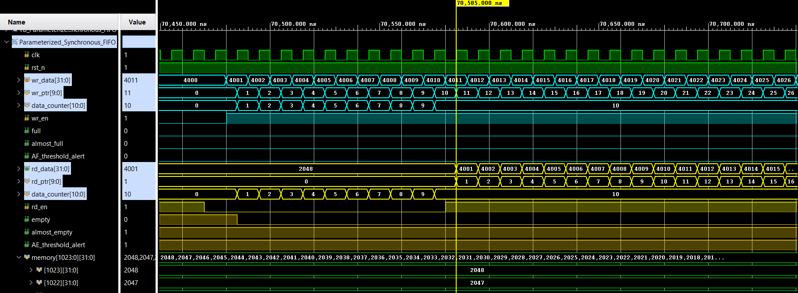

# Simulation Results & Waveform Timing Analysis: Parameterized Synchronous FIFO

This directory contains simulation waveforms captured from the **AMD Vivado Simulator (`xsim`)** verifying the functionality, multi-tier status flags, overflow/underflow protection, and simultaneous read/write operations of the `Parameterized_Synchronous_FIFO` core.

---

## 📸 Simulation Waveform Manifest

| Image File | Verification Scenario | Key Feature Demonstrated |
|:---|:---|:---|
| [`Reset_state.png`](Reset_state.png) | Asynchronous Reset & Initialization | Initial state clearance, pointer zeroing, initial empty flag assertion |
| [`empty_signals.png`](empty_signals.png) | Filling FIFO from Empty | Deassertion progression of `empty`, `almost_empty`, and `AE_threshold_alert` |
| [`full_signals.png`](full_signals.png) | Filling FIFO to Capacity | Multi-tier progression of `AF_threshold_alert`, `almost_full`, and `full` |
| [`read_operation.png`](read_operation.png) | Draining FIFO via Read Strobes | First-In First-Out data ordering and empty flag re-assertion |
| [`write_overflow.png`](write_overflow.png) | Over-Capacity Write Protection | Prevention of memory corruption when writes exceed 1024 capacity |
| [`read_overflow.png`](read_overflow.png) | Under-Capacity Read Protection | Prevention of negative counter underflow when reading empty FIFO |
| [`continuous_write_n_read.png`](continuous_write_n_read.png) | Concurrent Read & Write | Simultaneous enqueue/dequeue maintaining constant fill level of 10 |

---

## 🔍 In-Depth Waveform Walkthrough

### 1. Reset Behavior & Initial States

* **Reset Timing:** `rst_n` goes low at $100.000\text{ ns}$ and deasserts at $200.000\text{ ns}$ ($100\text{ ns}$ duration).
* **Signals at Reset:**
  * `wr_ptr = 0`, `rd_ptr = 0`, `data_counter = 0`.
  * `empty = 1`, `almost_empty = 1`, `AE_threshold_alert = 1`.
  * `full = 0`, `almost_full = 0`, `AF_threshold_alert = 0`.
* **First Write ($205\text{ ns}$):** As soon as `rst_n` is released, the first write strobe arrives. `data_counter` and `wr_ptr` begin incrementing in lockstep.

---

### 2. Empty Flag Deassertion Progression

As data is pushed into the empty FIFO, the three empty-related flags deassert in order of occupancy thresholds:

* **Item 1 (`data_counter = 1`):** `empty` immediately deasserts to `0`.
* **Item 11 (`data_counter = 11 > AE = 10`):** `almost_empty` deasserts to `0`.
* **Item 101 (`data_counter = 101 > AE_THRESHOLD = 100`):** `AE_threshold_alert` deasserts to `0`.
* **Conclusion:** Proves that all three low-watermark flags respond accurately to rising FIFO occupancy.

---

### 3. Multi-Tier Full Flag Progression

As the FIFO approaches its maximum 1024-word capacity, the full status flags assert in structured progression:

* **Item 1000 (`data_counter = 1000`):** `AF_threshold_alert` asserts high (`1'b1`), providing an early warning interrupt threshold.
* **Item 1014 (`data_counter = 1014 = FIFO_DEPTH - AF`):** `almost_full` asserts high (`1'b1`).
* **Item 1024 (`data_counter = 1024`):** `full` asserts high (`1'b1`).
* **Pointer Rollover:** `wr_ptr` rolls over cleanly from `1023` back to `0`.

---

### 4. Read Operation & First-In First-Out Integrity

* **Data Sequence Verification:** As `rd_en = 1` drains the buffer, `rd_data` outputs the exact sequential values written earlier: `1001, 1002, 1003, ..., 1024`.
* **Counter Decrement:** `data_counter` counts down smoothly ($24 \rightarrow 23 \rightarrow \dots \rightarrow 0$).
* **Empty Flag Re-assertion:**
  * When `data_counter <= 100`: `AE_threshold_alert` asserts high.
  * When `data_counter <= 10`: `almost_empty` asserts high.
  * When `data_counter == 0`: `empty` asserts high.
  * `rd_ptr` rolls over cleanly from `1023` back to `0`.

---

### 5. Hardware Write-Overflow Protection

* **Test Sequence:** With the FIFO completely full (`data_counter = 1024`, `full = 1`), the testbench maintains `wr_en = 1` while incrementing `wr_data` continuously up to `4000` (nearly $4\times$ capacity).
* **Observed Hardware Behavior:**
  * `data_counter` remains clamped at `1024`.
  * `wr_ptr` does not advance past `0`.
  * Memory contents are preserved from overwriting unread valid data.

---

### 6. Hardware Read-Underflow Protection

* **Test Sequence:** After completely draining the FIFO (`data_counter = 0`, `empty = 1`), the testbench pulses `rd_en = 1` for 2000 continuous clock cycles.
* **Observed Hardware Behavior:**
  * `data_counter` remains clamped at `0` (no negative underflow or integer rollover to `2047`).
  * `rd_ptr` does not increment.
  * `empty` remains solidly high (`1'b1`).

---

### 7. Simultaneous Concurrent Read & Write

* **Test Sequence:** The FIFO is pre-loaded with 10 words. At $70.585\ \mu\text{s}$, both `wr_en = 1` and `rd_en = 1` are asserted simultaneously for continuous streaming.
* **Observed Hardware Behavior:**
  * `wr_ptr` and `rd_ptr` advance synchronously in lockstep (`11, 12, 13...` vs `1, 2, 3...`).
  * `data_counter` remains constant at **10**, validating the net-zero counter logic (`case 2'b11: data_counter <= data_counter`).
  * `rd_data` streams out continuous sequential words (`4001, 4002, 4003...`) with zero missing or duplicate data.

---

## 📊 Verification Test Matrix

| Test Scenario | Condition | Expected Result | Measured Hardware Result | Status |
|:---|:---|:---|:---|:---:|
| **Asynchronous Reset** | `rst_n = 0` | Pointers & counter = 0, empty flags = 1 | Confirmed in `Reset_state.png` | **PASS** |
| **Empty Flag Thresholds** | Write elements 1 to 101 | Sequential deassertion of `empty`, `almost_empty`, `AE_alert` | Confirmed in `empty_signals.png` | **PASS** |
| **Full Flag Thresholds** | Write elements 1000 to 1024 | Sequential assertion of `AF_alert`, `almost_full`, `full` | Confirmed in `full_signals.png` | **PASS** |
| **FIFO Read Integrity** | Sequential read 1 to 1024 | Exact first-in first-out data ordering | Confirmed in `read_operation.png` | **PASS** |
| **Write Overflow Immunity** | Continuous write while full | `data_counter` capped at 1024, memory preserved | Confirmed in `write_overflow.png` | **PASS** |
| **Read Underflow Immunity** | Continuous read while empty | `data_counter` clamped at 0, no negative roll | Confirmed in `read_overflow.png` | **PASS** |
| **Simultaneous Read/Write** | Concurrent `wr_en` & `rd_en` | Constant occupancy, lockstep pointer progression | Confirmed in `continuous_write_n_read.png` | **PASS** |
